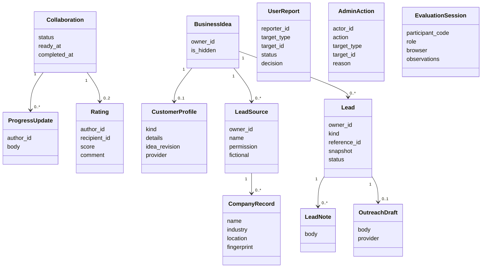

# Sprint 3 architecture additions

The existing layers and opportunity model remain in place. UUID identifiers, timestamp mixins, role checks, row locks and PostgreSQL constraints follow previous sprints. The diagrams below describe the additions; existing Sprint 1 and Sprint 2 fields remain applicable.



Figure 1. Sprint 3 additions to collaboration tracking and the private customer-discovery workspace. Report targets and lead references are polymorphic UUIDs whose validity is checked by services; no false database foreign-key relationship is drawn for them. Ratings link to the author, recipient and completed collaboration through real foreign keys.

```mermaid
sequenceDiagram
  actor Innovator
  participant UI as Next.js interface
  participant API as FastAPI collaboration service
  participant DB as PostgreSQL
  actor Owner
  Innovator->>UI: Add progress and mark work ready
  UI->>API: Authenticated update / ready request
  API->>DB: Lock collaboration and check selected participants
  API->>DB: Save update or active-to-ready transition
  API-->>UI: Persisted state
  Owner->>UI: Review work and confirm completion
  UI->>API: Complete request
  API->>DB: Lock collaboration; require owner and ready state
  alt Permitted transition
    API->>DB: Save completed state and time
    API-->>UI: Completion confirmed; ratings available
  else Invalid participant or state
    API-->>UI: Clear access or conflict response
  end
```

Figure 2. Completion preserves the innovator-ready and owner-confirmation responsibilities required by US17.

```mermaid
sequenceDiagram
  actor Owner
  participant UI as Customer and lead workspace
  participant API as FastAPI services
  participant AI as Server-side Gemini adapter
  participant DB as PostgreSQL
  Owner->>UI: Generate target profile for saved idea
  UI->>API: Authenticated generation request with customer focus
  API->>DB: Check ownership and snapshot saved idea/profile
  API->>AI: Submitted context and bounded JSON requirements
  alt Valid response and unchanged source
    AI-->>API: Proposed profile and assumptions
    API->>DB: Recheck source and save profile
    API-->>UI: Editable saved suggestion
  else Provider failure or source changed
    API-->>UI: Retry/conflict message; saved profile retained
  end
  Owner->>UI: Import permission-confirmed business CSV
  UI->>API: Bounded company data and source attestation
  API->>API: Validate whole file and resolve duplicates
  API->>DB: Save provenance and valid new company records
  Owner->>UI: Save a suggested customer or investor
  UI->>API: Save referenced opportunity for owned idea
  API->>DB: Reuse duplicate or save private lead snapshot
  API-->>UI: Saved lead, notes and draft workspace
```

Figure 3. Customer discovery uses saved owner context and permitted company records. Consumer focus returns segments/channels rather than company contacts. Outreach uses the same server-only generation adapter and does not include a sending step.
